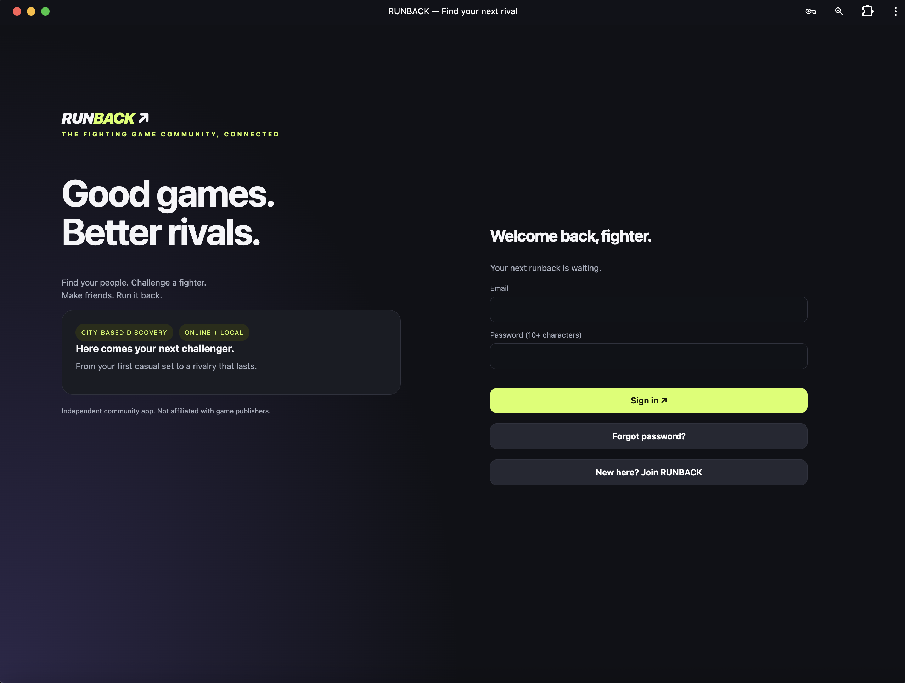
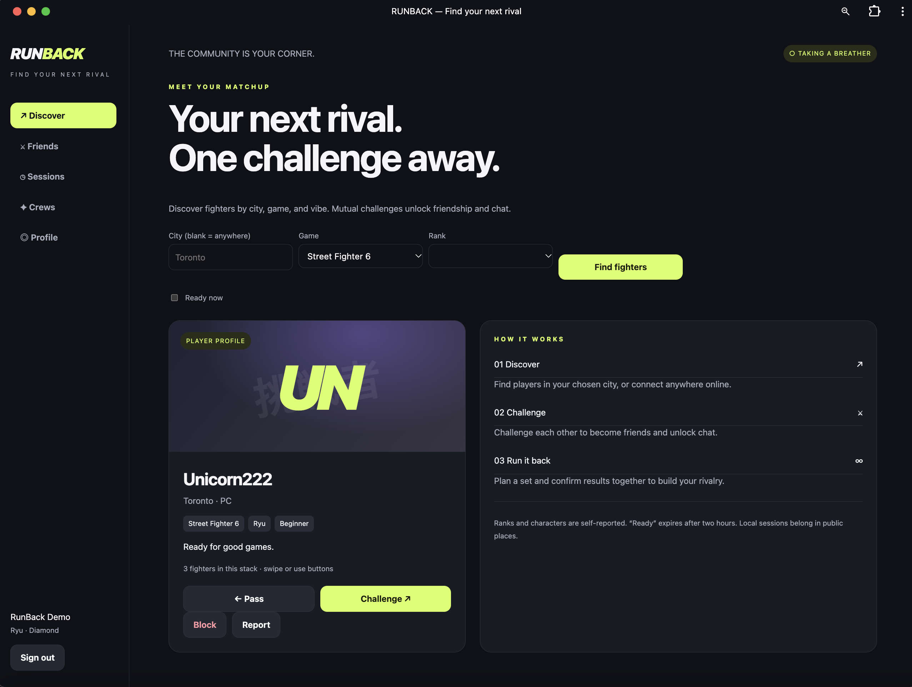
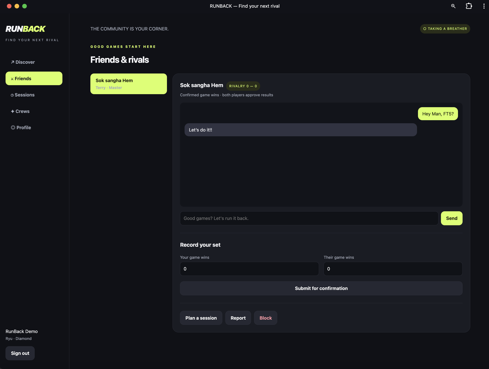
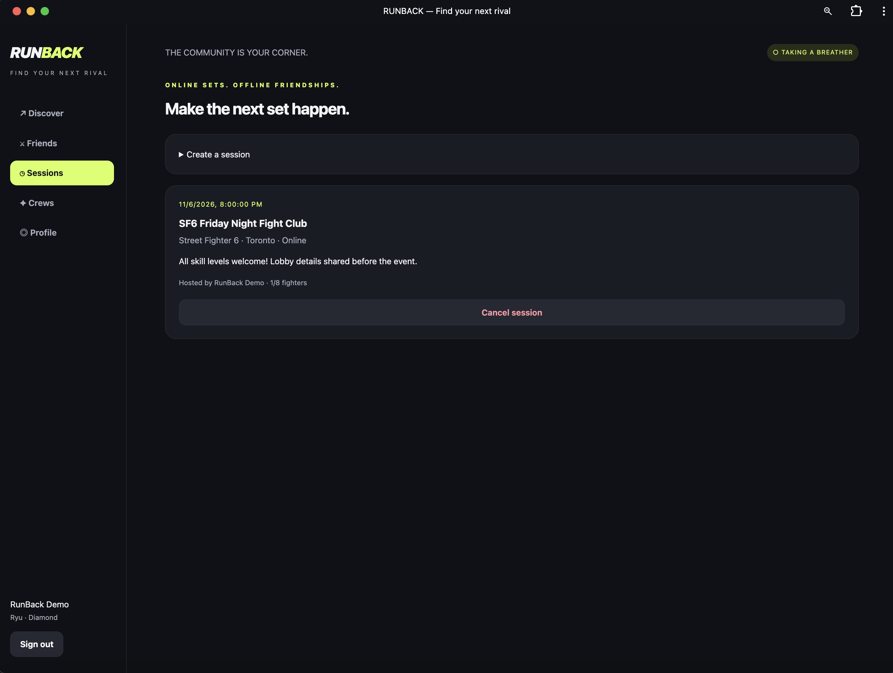
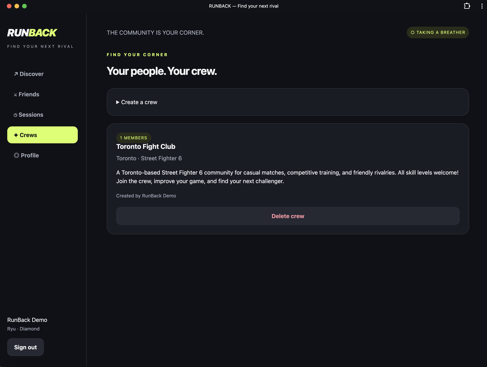
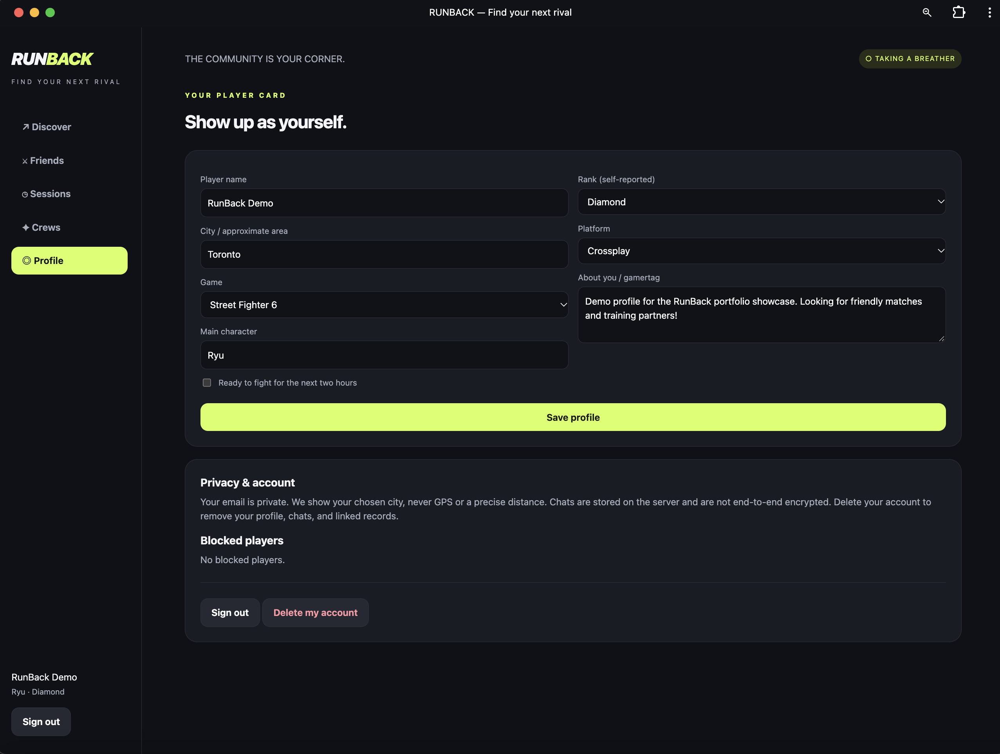

# RunBack

**Find fighters. Make rivals. Run it back.**

RunBack is an independent, full-stack web application that helps fighting-game players discover opponents, build rivalries, chat with mutual connections, and organize online or local gaming sessions. It is designed for desktop and mobile browsers.

> **Project status:** Functional MVP and portfolio project. Not yet a fully operated public social platform.

## Highlights

- **Player discovery:** Filter by city, fighting game, self-reported rank, and ready-to-play status; challenge or pass on profiles.
- **Mutual connections and chat:** Two-way challenges unlock friendships and private, database-stored messaging.
- **Sessions and crews:** Create online or local meetups, manage attendance, and organize gaming groups.
- **Rivalry results:** Submit match scores for confirmation by the other player.
- **Community moderation:** Block or report users; moderators can review reports and suspend accounts.
- **Account management:** Registration, sign-in, profile editing, password recovery (when email is configured), and account deletion.

## Technology stack

| Layer | Technologies |
| --- | --- |
| Backend | Python, WSGI API |
| Frontend | Vanilla JavaScript, HTML, CSS |
| Databases | SQLite for local development; PostgreSQL for deployment |
| Production serving | Gunicorn |
| Password recovery | Brevo email API (optional configuration) |
| Testing | Python `unittest`, isolated SQLite test databases |

## Engineering decisions

RunBack uses server-side password hashing (PBKDF2-SHA256 for new passwords), expiring sessions stored as hashed tokens, HTTP-only session cookies, CSRF validation for authenticated state-changing requests, parameterized database queries, and escaped user-generated content in the interface. The application also implements a restrictive Content Security Policy.

These controls reduce common risks, but **do not constitute a completed security audit**. In particular, production email delivery, PostgreSQL concurrency, and broad browser/device compatibility need separate verification.

## Run locally

**Prerequisite:** Python 3.10+

```bash
python -m pip install -r requirements.txt
python main.py
```

Open the local URL shown in the terminal (typically `http://localhost:3000`). The app uses SQLite by default for local development.

## Run automated tests

```bash
python -m unittest -v test_app test_recovery
node --check public/app.js
```

The Python tests focus on account suspension, access restrictions, blocking, and password recovery. They are regression tests, not a complete end-to-end suite.

## Deployment notes

Production requires persistent PostgreSQL storage. Set `DATABASE_URL` to a private PostgreSQL connection string and `RUNBACK_PRODUCTION=1` in your hosting environment. Configure `ADMIN_EMAIL` for moderation; keep `DEMO_MODE` disabled for real users.

Example production command:

```bash
RUNBACK_PRODUCTION=1 gunicorn --preload --bind 0.0.0.0:3000 --workers 2 --threads 4 main:application
```

For password recovery, configure `BREVO_API_KEY`, `EMAIL_FROM`, and a public HTTPS `APP_URL` as environment secrets. Never commit real credentials, production databases, or `.env` files.

## Screenshots

*Screenshots coming soon: player discovery, friends/chat, sessions, and player profile.*

## Current limitations and next steps

This is an MVP. It does not include email verification, push notifications, voice/video, automatic game-stat synchronization, verified venues, or GPS radius matching. City filters are text-based; player ranks are self-reported. Chats are **not end-to-end encrypted**. Registration uses an 18+ self-attestation rather than identity verification.

Before a wider public launch, priorities include stronger anti-abuse controls, email verification, production monitoring and backups, privacy/community policies, and operational moderation.

## AI-Assisted Development Workflow

I incorporate AI-assisted tools into my software development workflow to accelerate prototyping, troubleshoot technical challenges, and improve development efficiency.

My workflow includes:

- **Planning:** Translating application ideas into technical requirements, features, and development milestones.
- **Development:** Using AI-assisted coding tools to generate, review, and refine application components.
- **Troubleshooting:** Investigating errors, evaluating suggested fixes, and iterating on solutions.
- **Testing:** Using automated tests and manual application testing to validate functionality.
- **Security awareness:** Reviewing authentication, authorization, data handling, and potential vulnerabilities before deployment.
- **Continuous improvement:** Refining application features based on testing and feedback.

**My approach:** AI accelerates development, while testing, technical understanding, and human oversight remain essential to delivering reliable software.

## About this project

I built RunBack to explore the complete lifecycle of a community web application—from authentication and relational data storage to responsive UI, moderation workflows, and automated regression testing. It demonstrates practical full-stack development and security-aware engineering decisions.

**Independent fan-community project. Not affiliated with Capcom or any fighting-game publisher.**

## Application Screenshots

Explore RunBack's interface, from finding your next rival to organizing matches and building a community.

### Login & Registration


### Fighter Discovery


### Friends & Messaging


### Gaming Sessions


### Community Crews


### Player Profiles

